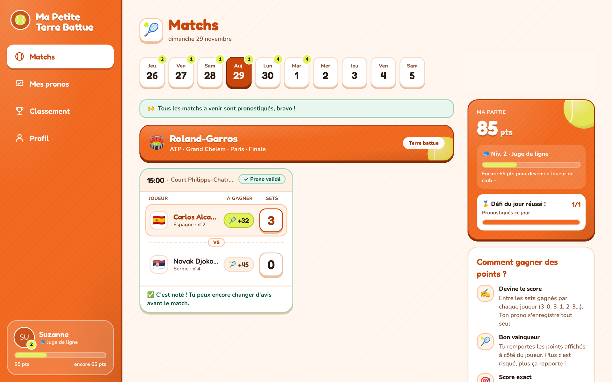
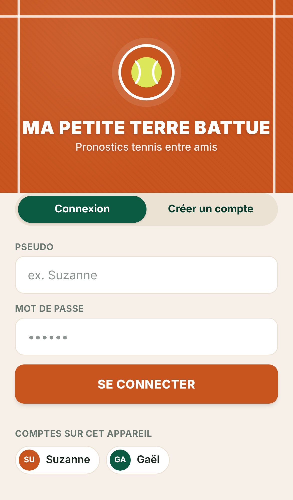
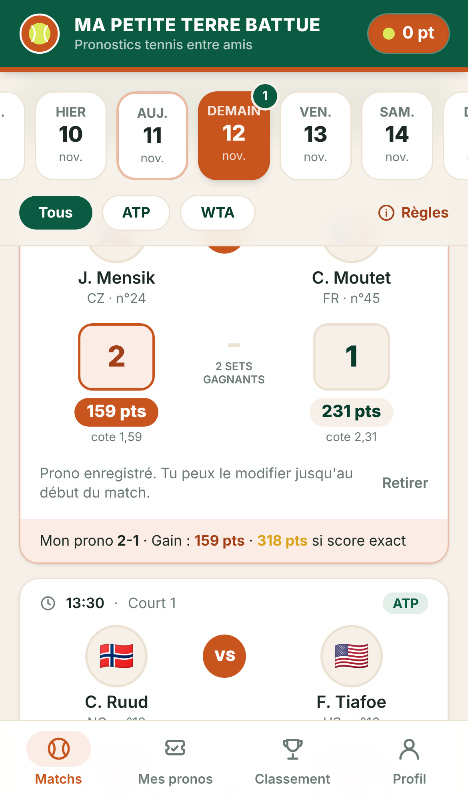
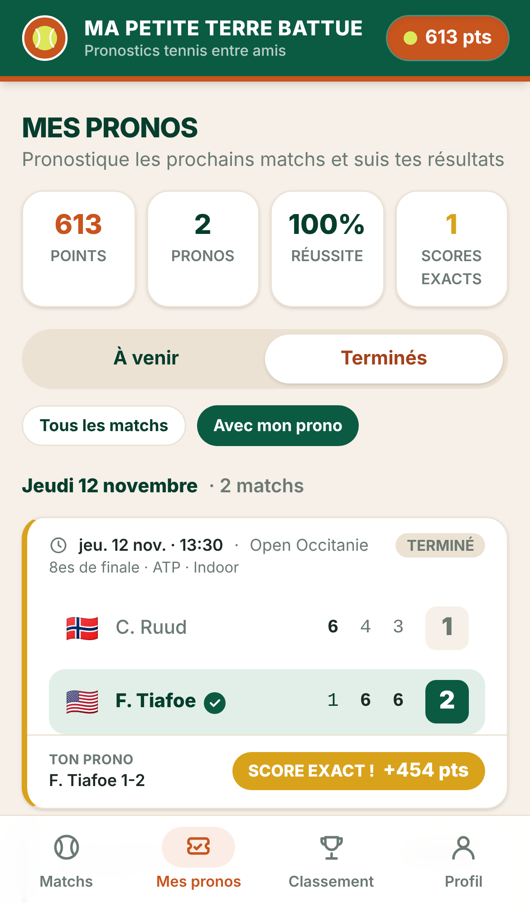
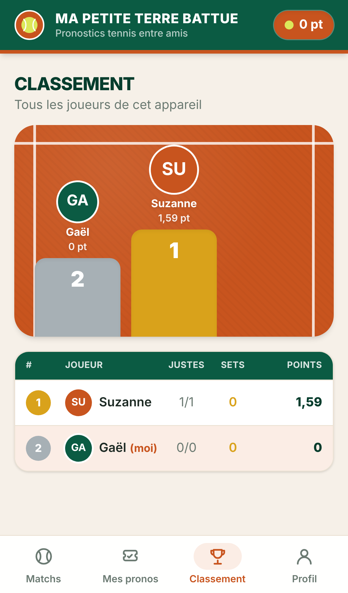

# 🎾 Ma Petite Terre Battue

Application web (PWA) de pronostics tennis entre amis, inspirée de *Mon Petit Prono*, aux couleurs de Roland-Garros
(vert profond, terre battue, blanc des lignes, jaune de la balle).

## Règles du jeu

Pour chaque match, le joueur saisit le **score en sets** : le nombre de sets gagnés par chacun des deux joueurs
(ex. 2-0, 2-1, 1-2, 0-2 en 2 sets gagnants ; 3-0, 3-1, 3-2… en Grand Chelem masculin). Sous chaque case, l'app affiche
les points que rapporte ce joueur s'il gagne (calculés comme **cote × 20** : cote 2,00 → 40 pts ; la cote
elle-même n'est pas affichée). Le prono est **enregistré automatiquement** dès que le score saisi est cohérent ;
vider les deux cases retire le prono.

| Pronostic | Points |
| --- | --- |
| Mauvais vainqueur | 0 |
| Bon vainqueur | **cote du vainqueur × 20**, arrondi (2,00 → 40 pts ; 1,47 → 29 pts) |
| Bon vainqueur **et** score en sets exact | **ces points × 1,5**, arrondi (40 → 60 pts ; 29 → 44 pts) |

- Le score saisi doit être cohérent : un seul vainqueur, qui remporte exactement le nombre de sets requis
  (impossible de saisir 2-2, 1-1 ou 3-0 dans un match en 2 sets gagnants). Sinon rien n'est enregistré et l'erreur
  est affichée sous les cases.
- On peut modifier ou retirer son prono jusqu'au début du match ; ensuite il est verrouillé.
- Classement : points, puis nombre de scores exacts, puis nombre de bons vainqueurs.

## Version 1 (actuelle) : 100 % locale

- **Pas d'API externe** : un générateur déterministe (`lib/mock/generator.ts`) simule chaque semaine un **tableau de
  Roland-Garros à 16 joueurs** (tableau masculin, 3 sets gagnants), têtes de série placées selon leur classement :
  8es de finale lundi et mardi, quarts mercredi et jeudi, demi-finales vendredi et samedi, finale dimanche. Les
  vainqueurs passent au tour suivant, et **un match n'apparaît qu'une fois ses deux joueurs connus** (la finale
  s'affiche quand les deux demi-finales sont terminées) ; en attendant, la page Matchs indique le tour à venir.
  Les résultats sont simulés une fois l'heure du match passée, pondérés par les cotes.
- **Pas d'e-mail** : comptes locaux pseudo + mot de passe (haché SHA-256 salé). Comptes et pronos sont stockés dans le
  `localStorage` du navigateur — tous les joueurs d'un même appareil partagent le classement.
- **Outils de démo** (page Profil) : avancer l'horloge de l'app, terminer les matchs en cours ou simuler tous les résultats
  du jour pour voir les points tomber.
- **Interface responsive** : navigation en bas sur mobile ; sur PC, menu dans l'en-tête, matchs sur deux colonnes
  et colonne latérale (total, règles, mini-classement).
- **PWA** : manifeste, icônes, service worker (installable sur l'écran d'accueil, pages consultables hors ligne).

## Design

Système de design inspiré de Roland-Garros, défini dans `app/globals.css` (jetons Tailwind) et `components/ui.tsx` :

- **Couleurs** : vert court (`court-*`, couleur principale : navigation, succès), terre battue (`clay-*`, accent et
  actions), jaune balle (décoratif), neutres chauds pour les fonds et les textes. Les textes respectent un contraste
  AA (≥ 4,5:1).
- **Typographie** : Barlow Condensed (titres, scores, chiffres) et Inter (texte), embarquées localement.
- **Mise en page** : barre latérale sur ordinateur, barre supérieure et onglets en bas sur mobile ; cartes de match en
  lignes (joueur · gain · sets) identiques pour les matchs à venir, en cours et terminés.
- **Accessibilité** : focus visible, lien d'évitement, libellés pour les lecteurs d'écran, cibles tactiles de 44 px,
  respect de « réduire les animations ».

## Données réelles : The Odds API + SportScore

L'app peut remplacer les matchs de démo par de vrais matchs :

| Rôle | API | Coût gratuit |
| --- | --- | --- |
| Programme des matchs + cotes avant match | [The Odds API](https://the-odds-api.com) (clé gratuite) | 500 crédits / mois |
| Scores et résultats | [SportScore](https://sportscore.com/developers/) (sans clé) | ~1 000 requêtes / 24 h / IP |
| Classements et nationalités | API publique d'ESPN (sans clé, non officielle) | 2 requêtes / semaine (le lundi) |

**Mise en route**

1. Crée un compte gratuit sur [the-odds-api.com](https://the-odds-api.com) pour recevoir ta clé par e-mail.
2. Copie `.env.example` en `.env.local` et renseigne `ODDS_API_KEY`. Garde `NEXT_PUBLIC_MATCH_SOURCE=api`.
3. **Arrête puis relance** `npm run dev` (ou `npm run build && npm start`) : `NEXT_PUBLIC_MATCH_SOURCE` n'est lue
   qu'au démarrage. La page **Profil → Données en direct** affiche l'état
   de la connexion et le quota restant.

**Fonctionnement**

- Tout passe par le serveur Next.js (`app/api/matches`, `app/api/status`) : la clé n'arrive jamais dans le navigateur
  et SportScore ne voit que l'adresse du serveur, jamais celle des joueurs.
- Les cotes sont mises à jour au plus toutes les 6 h (≈ 1 crédit par tournoi actif), puis **figées au début du
  match**. Cote retenue : médiane des bookmakers européens.
- Les scores ne sont demandés à SportScore que s'il reste des matchs commencés sans résultat (toutes les 3 min au plus).
- Les matchs vus sont gardés dans `.data/matches.json` (The Odds API ne renvoie plus un match terminé). Ce fichier
  sera remplacé par la base de données.
- **Circuits et tournois suivis** (`lib/settings.ts`) : pour l'instant **uniquement Roland-Garros, tableau masculin**
  (`ENABLED_TOURS = ["ATP"]`, `ENABLED_TOURNAMENTS = ["french_open"]`), avec les matchs de démo comme avec les vraies
  données. Les autres tournois et la WTA ne sont ni interrogés (aucun crédit dépensé) ni affichés. Hors période du
  tournoi (fin mai – début juin), la page Matchs l'indique dans un bandeau. Pour suivre tous les tournois :
  `ENABLED_TOURNAMENTS = null` ; pour réactiver la WTA : `ENABLED_TOURS = ["ATP", "WTA"]`.
- The Odds API ne couvre que les grands tournois (Grand Chelem, ATP/WTA 1000 et 500), **pas la Coupe Davis**, et ne
  fournit ni classement ni pays des joueurs.
- Classement et nationalité viennent d'ESPN (150 premiers ATP, rafraîchis chaque lundi à partir de 12:00 UTC, jour de publication des classements), rapprochés par
  nom complet. Un joueur hors des 150 premiers garde ses initiales à la place du drapeau. Cette API n'est pas
  officielle et peut changer sans préavis : en cas d'échec, l'app garde le dernier classement connu.
- La mention « Powered by SportScore » est obligatoire (conditions de l'offre gratuite) et s'affiche en bas des pages.
- Le format de SportScore a été vérifié sur l'API réelle (extrait dans `tests/fixtures/`). Il ne donne que le nombre
  de sets gagnés (pas le score de chaque set). Si un match sort de la liste des 50 derniers matchs, son détail est
  consulté (5 au plus par mise à jour). `/api/status` montre un échantillon brut de la dernière réponse.
- **Intersaison** : entre la fin de saison (fin novembre) et le début de l'Open d'Australie, The Odds API ne propose
  aucun tournoi de tennis actif. La page Matchs l'indique dans un bandeau.
- Si le serveur passe par un proxy d'entreprise, lance Node avec `NODE_USE_ENV_PROXY=1` (Node ≥ 22.21) pour que
  ses requêtes utilisent `HTTPS_PROXY`.

Sans clé (ou avec `NEXT_PUBLIC_MATCH_SOURCE=mock`), l'app garde les matchs de démo et ses outils de simulation.

## Stack

- Polices Inter et Barlow Condensed via Fontsource (sans appel réseau)
- [Next.js 16](https://nextjs.org) (App Router, Turbopack) + React 19 + TypeScript
- Tailwind CSS 4 (thème défini dans `app/globals.css`)
- Vitest pour les tests unitaires
- Aucune dépendance runtime en dehors de Next/React

## Lancer le projet

```bash
npm install
npm run dev        # http://localhost:3000
npm test           # tests unitaires (règles de points, générateur, comptes, classement)
npm run typecheck
npm run build && npm start   # version de production (le service worker n'est actif qu'en production)
```

Avec Docker : `docker compose up --build`.

> Pour installer la PWA sur un téléphone, il faut servir l'app en HTTPS (ou via `localhost`) : par exemple
> `npx next dev --experimental-https`, ou un tunnel HTTPS.

## Architecture

```
app/
  connexion/            connexion / création de compte local
  (app)/matchs/         programme du jour, cotes, saisie des pronos
  (app)/pronos/         tous les matchs à venir (avec ou sans prono) et terminés (score + résultat du prono)
  (app)/classement/     podium et classement
  (app)/profil/         profil, règles, outils de démo, déconnexion
  manifest.ts           manifeste PWA
components/             UI (MatchCard, AppShell, DayPicker…) et AppProvider (session, horloge, données)
lib/
  types.ts              modèle de données
  scoring.ts            calcul des points
  game.ts               validation des pronos, statistiques, classement
  auth.ts               comptes locaux
  providers/            source des matchs et des cotes   ← à remplacer par l'API
  repository/           stockage utilisateurs + pronos   ← à remplacer par la base de données
  mock/, data/          générateur de matchs fictifs, joueurs, tournois
public/sw.js            service worker
tests/                  tests Vitest
```

## Prochaines étapes prévues

1. **API de cotes** : implémenter un nouveau `MatchProvider` (`lib/providers/types.ts`) qui interroge une API de
   cotes/résultats côté serveur (route handler Next.js, clé API dans `.env.local`) — l'interface ne change pas.
2. **Base de données** : implémenter `Repository` (`lib/repository/types.ts`) au-dessus d'une base (par ex. PostgreSQL
   ou SQLite via Prisma/Drizzle) exposée par des route handlers, avec une authentification serveur (sessions/cookies).
3. Ligues privées entre amis, notifications push avant les matchs.

## Aperçu

**Sur PC**



**Sur mobile**

| Connexion | Matchs | Mes pronos | Classement |
| --- | --- | --- | --- |
|  |  |  |  |
