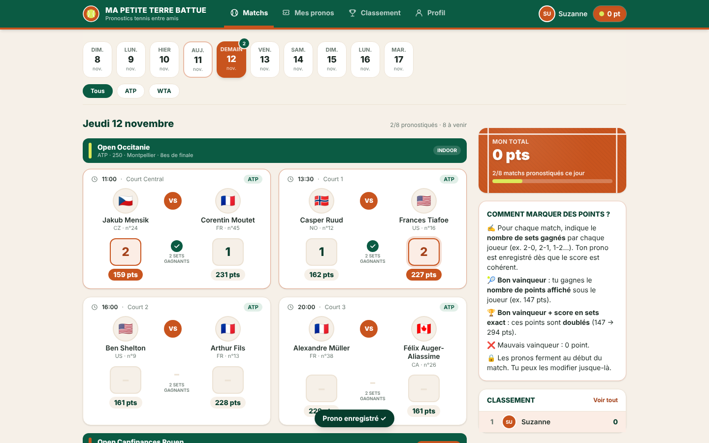
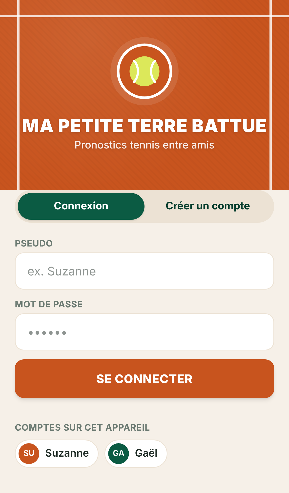
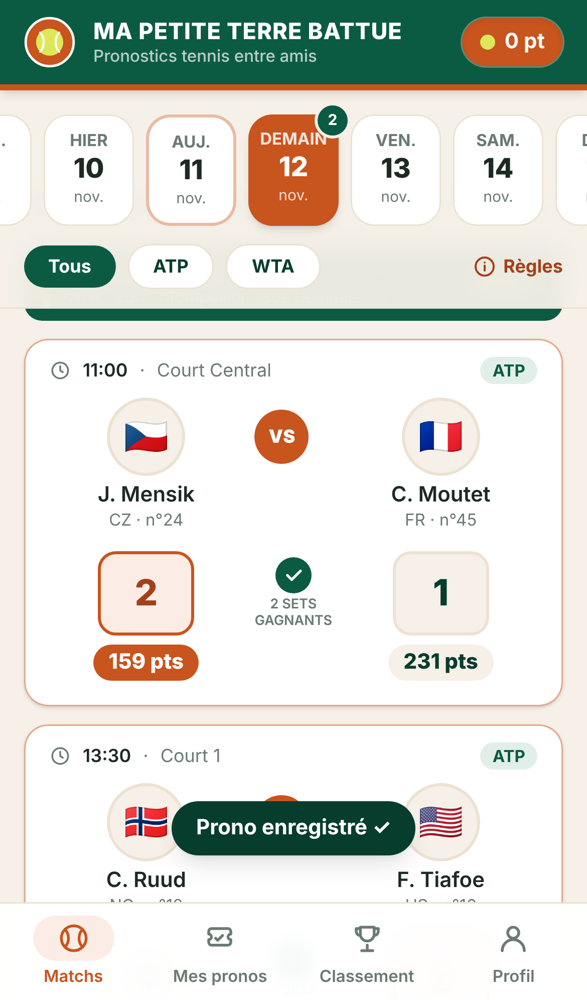
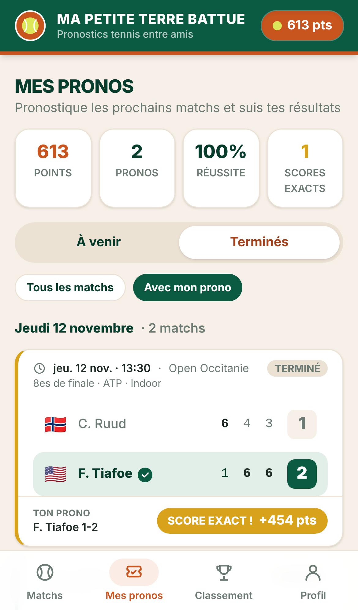
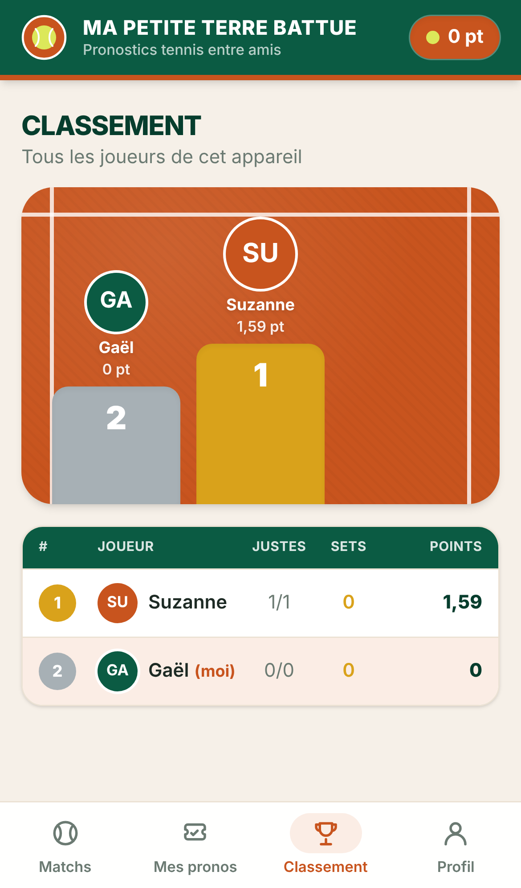

# 🎾 Ma Petite Terre Battue

Application web (PWA) de pronostics tennis entre amis, inspirée de *Mon Petit Prono*, aux couleurs de Roland-Garros
(vert profond, terre battue, blanc des lignes, jaune de la balle).

## Règles du jeu

Pour chaque match, le joueur saisit le **score en sets** : le nombre de sets gagnés par chacun des deux joueurs
(ex. 2-0, 2-1, 1-2, 0-2 en 2 sets gagnants ; 3-0, 3-1, 3-2… en Grand Chelem masculin). Sous chaque case, l'app affiche
les points que rapporte ce joueur s'il gagne (calculés comme **cote × 100** : cote 1,47 → 147 pts ; la cote
elle-même n'est pas affichée). Le prono est **enregistré automatiquement** dès que le score saisi est cohérent ;
vider les deux cases retire le prono.

| Pronostic | Points |
| --- | --- |
| Mauvais vainqueur | 0 |
| Bon vainqueur | **cote du vainqueur × 100** (1,47 → 147 pts) |
| Bon vainqueur **et** score en sets exact | **le double** (1,47 → 294 pts) |

- Le score saisi doit être cohérent : un seul vainqueur, qui remporte exactement le nombre de sets requis
  (impossible de saisir 2-2, 1-1 ou 3-0 dans un match en 2 sets gagnants). Sinon rien n'est enregistré et l'erreur
  est affichée sous les cases.
- On peut modifier ou retirer son prono jusqu'au début du match ; ensuite il est verrouillé.
- Classement : points, puis nombre de scores exacts, puis nombre de bons vainqueurs.

## Version 1 (actuelle) : 100 % locale

- **Pas d'API externe** : un générateur déterministe (`lib/mock/generator.ts`) produit un programme de matchs fictif
  (tournois ATP/WTA, joueurs, cotes, horaires) pour chaque jour. Les résultats sont simulés une fois l'heure du match passée,
  pondérés par les cotes.
- **Pas d'e-mail** : comptes locaux pseudo + mot de passe (haché SHA-256 salé). Comptes et pronos sont stockés dans le
  `localStorage` du navigateur — tous les joueurs d'un même appareil partagent le classement.
- **Outils de démo** (page Profil) : avancer l'horloge de l'app, terminer les matchs en cours ou simuler tous les résultats
  du jour pour voir les points tomber.
- **Interface responsive** : navigation en bas sur mobile ; sur PC, menu dans l'en-tête, matchs sur deux colonnes
  et colonne latérale (total, règles, mini-classement).
- **PWA** : manifeste, icônes, service worker (installable sur l'écran d'accueil, pages consultables hors ligne).

## Stack

- [Next.js 16](https://nextjs.org) (App Router, Turbopack) + React 19 + TypeScript
- Tailwind CSS 4 (thème défini dans `app/globals.css`)
- Vitest pour les tests unitaires
- Aucune dépendance runtime en dehors de Next/React

## Lancer le projet

```bash
npm install
npm run dev        # http://localhost:3000
npm test           # tests unitaires (règles de points, générateur, comptes, classement)
npm run typecheck
npm run build && npm start   # version de production (le service worker n'est actif qu'en production)
```

Avec Docker : `docker compose up --build`.

> Pour installer la PWA sur un téléphone, il faut servir l'app en HTTPS (ou via `localhost`) : par exemple
> `npx next dev --experimental-https`, ou un tunnel HTTPS.

## Architecture

```
app/
  connexion/            connexion / création de compte local
  (app)/matchs/         programme du jour, cotes, saisie des pronos
  (app)/pronos/         tous les matchs à venir (avec ou sans prono) et terminés (score + résultat du prono)
  (app)/classement/     podium et classement
  (app)/profil/         profil, règles, outils de démo, déconnexion
  manifest.ts           manifeste PWA
components/             UI (MatchCard, AppShell, DayPicker…) et AppProvider (session, horloge, données)
lib/
  types.ts              modèle de données
  scoring.ts            calcul des points
  game.ts               validation des pronos, statistiques, classement
  auth.ts               comptes locaux
  providers/            source des matchs et des cotes   ← à remplacer par l'API
  repository/           stockage utilisateurs + pronos   ← à remplacer par la base de données
  mock/, data/          générateur de matchs fictifs, joueurs, tournois
public/sw.js            service worker
tests/                  tests Vitest
```

## Prochaines étapes prévues

1. **API de cotes** : implémenter un nouveau `MatchProvider` (`lib/providers/types.ts`) qui interroge une API de
   cotes/résultats côté serveur (route handler Next.js, clé API dans `.env.local`) — l'interface ne change pas.
2. **Base de données** : implémenter `Repository` (`lib/repository/types.ts`) au-dessus d'une base (par ex. PostgreSQL
   ou SQLite via Prisma/Drizzle) exposée par des route handlers, avec une authentification serveur (sessions/cookies).
3. Ligues privées entre amis, notifications push avant les matchs.

## Aperçu

**Sur PC**



**Sur mobile**

| Connexion | Matchs | Mes pronos | Classement |
| --- | --- | --- | --- |
|  |  |  |  |
